# Architecture Overview

<cite>
**Referenced Files in This Document**
- [README.md](file://README.md)
- [package.json](file://package.json)
- [next.config.ts](file://next.config.ts)
- [app/layout.tsx](file://app/layout.tsx)
- [app/page.tsx](file://app/page.tsx)
- [prisma/schema.prisma](file://prisma/schema.prisma)
- [lib/db.ts](file://lib/db.ts)
- [lib/env.ts](file://lib/env.ts)
- [lib/cart-domain.ts](file://lib/cart-domain.ts)
- [lib/cart-types.ts](file://lib/cart-types.ts)
- [lib/cart.ts](file://lib/cart.ts)
- [actions/cart.ts](file://actions/cart.ts)
- [lib/orders.ts](file://lib/orders.ts)
- [actions/checkout.ts](file://actions/checkout.ts)
- [lib/rate-limit.ts](file://lib/rate-limit.ts)
- [lib/crypto.ts](file://lib/crypto.ts)
- [components/storefront/site-header.tsx](file://components/storefront/site-header.tsx)
- [app/api/webhooks/payments/route.ts](file://app/api/webhooks/payments/route.ts)
</cite>

## Table of Contents
1. Introduction
2. Project Structure
3. Core Components
4. Architecture Overview
5. Detailed Component Analysis
6. Dependency Analysis
7. Performance Considerations
8. Troubleshooting Guide
9. Conclusion

## Introduction
Art Passion is a Next.js App Router e-commerce storefront for handmade products. It uses server components and server actions to render pages, manage the shopping cart, and place orders. The system integrates with a Neon PostgreSQL database through Prisma ORM, styles the UI with Tailwind CSS and shadcn/ui, and runs on React 19 with TypeScript.

Key goals:
- Provide a fast, accessible storefront with product browsing, cart management, and checkout.
- Keep business logic in server-side modules while exposing safe server actions to the client.
- Enforce security around cookies, order access tokens, and rate limits.
- Prepare for future payment integration through a webhook endpoint.

**Section sources**
- [README.md:1-44](file://README.md#L1-L44)
- [package.json:24-50](file://package.json#L24-L50)

## Project Structure
The repository follows a feature-oriented layout under `app` for routes, `components` for UI, `lib` for business logic and data access, and `actions` for server actions.

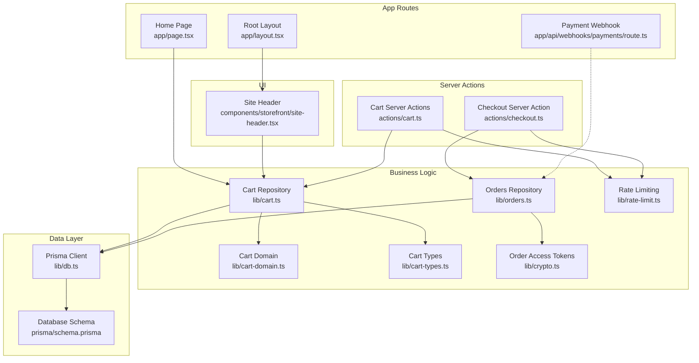

**Diagram sources**
- [app/layout.tsx:1-94](file://app/layout.tsx#L1-L94)
- [app/page.tsx:1-214](file://app/page.tsx#L1-L214)
- [app/api/webhooks/payments/route.ts:1-10](file://app/api/webhooks/payments/route.ts#L1-L10)
- [actions/cart.ts:1-162](file://actions/cart.ts#L1-L162)
- [actions/checkout.ts:1-110](file://actions/checkout.ts#L1-L110)
- [lib/cart-domain.ts:1-82](file://lib/cart-domain.ts#L1-L82)
- [lib/cart-types.ts:1-41](file://lib/cart-types.ts#L1-L41)
- [lib/cart.ts:1-322](file://lib/cart.ts#L1-L322)
- [lib/orders.ts:1-224](file://lib/orders.ts#L1-L224)
- [lib/rate-limit.ts:1-54](file://lib/rate-limit.ts#L1-L54)
- [lib/crypto.ts:1-29](file://lib/crypto.ts#L1-L29)
- [lib/db.ts:1-23](file://lib/db.ts#L1-L23)
- [prisma/schema.prisma:1-193](file://prisma/schema.prisma#L1-L193)
- [components/storefront/site-header.tsx:1-20](file://components/storefront/site-header.tsx#L1-L20)

**Section sources**
- [app/layout.tsx:1-94](file://app/layout.tsx#L1-L94)
- [app/page.tsx:1-214](file://app/page.tsx#L1-L214)
- [actions/cart.ts:1-162](file://actions/cart.ts#L1-L162)
- [actions/checkout.ts:1-110](file://actions/checkout.ts#L1-L110)
- [lib/cart.ts:1-322](file://lib/cart.ts#L1-L322)
- [lib/orders.ts:1-224](file://lib/orders.ts#L1-L224)
- [lib/db.ts:1-23](file://lib/db.ts#L1-L23)
- [prisma/schema.prisma:1-193](file://prisma/schema.prisma#L1-L193)

## Core Components
- Application shell and metadata are defined in the root layout, including fonts, theme provider, header, footer, and global styles.
- The home page fetches published categories and products using server-side queries and renders storefront sections.
- The cart is persisted via a signed cookie and backed by a database cart entity.
- Checkout validates input, enforces idempotency, locks inventory, and creates an order with a secure access token.
- Environment variables are validated at startup.
- Database access is centralized through a shared Prisma client configured for Neon.

**Section sources**
- [app/layout.tsx:1-94](file://app/layout.tsx#L1-L94)
- [app/page.tsx:1-214](file://app/page.tsx#L1-L214)
- [lib/env.ts:1-25](file://lib/env.ts#L1-L25)
- [lib/db.ts:1-23](file://lib/db.ts#L1-L23)

## Architecture Overview
The system follows a layered architecture:
- Presentation layer: Next.js App Router pages and server components.
- Interaction layer: Server actions that validate inputs and orchestrate operations.
- Business logic layer: Domain functions and repositories implementing cart and order workflows.
- Data access layer: Prisma client connected to Neon PostgreSQL.

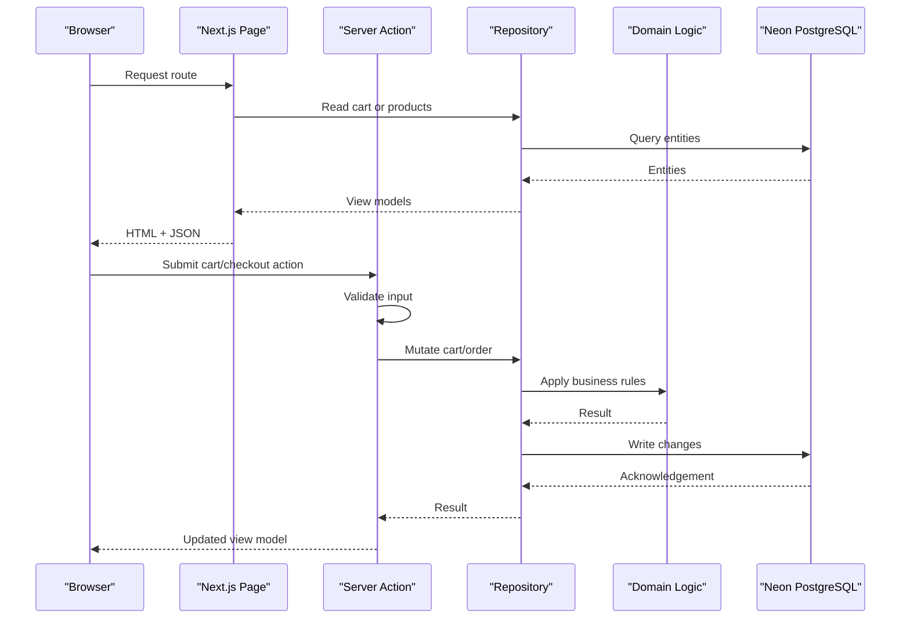

**Diagram sources**
- [app/page.tsx:1-214](file://app/page.tsx#L1-L214)
- [actions/cart.ts:1-162](file://actions/cart.ts#L1-L162)
- [actions/checkout.ts:1-110](file://actions/checkout.ts#L1-L110)
- [lib/cart.ts:1-322](file://lib/cart.ts#L1-L322)
- [lib/orders.ts:1-224](file://lib/orders.ts#L1-L224)
- [lib/cart-domain.ts:1-82](file://lib/cart-domain.ts#L1-L82)
- [lib/db.ts:1-23](file://lib/db.ts#L1-L23)

## Detailed Component Analysis

### Application Shell and Metadata
- Root layout configures fonts, theme provider, site header/footer, accessibility skip link, and global metadata.
- It composes presentation components and provides a consistent document structure.

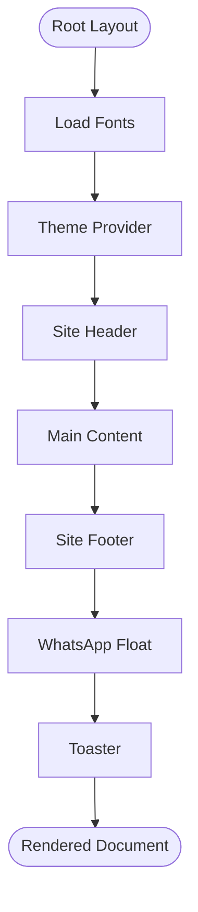

**Diagram sources**
- [app/layout.tsx:1-94](file://app/layout.tsx#L1-L94)

**Section sources**
- [app/layout.tsx:1-94](file://app/layout.tsx#L1-L94)

### Home Page and Product Catalog
- The home page performs parallel reads for categories and products, slices featured and new arrivals, and builds a WhatsApp contact link.
- It renders category cards and product grids using reusable storefront components.

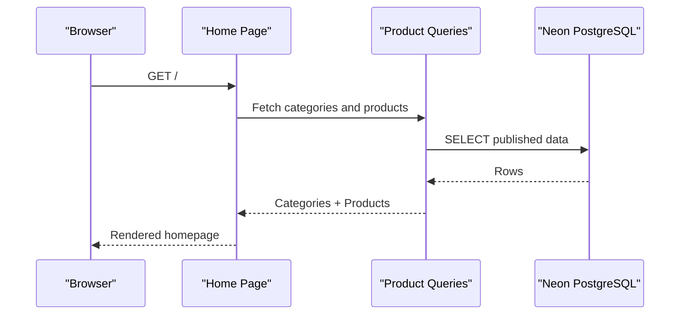

**Diagram sources**
- [app/page.tsx:1-214](file://app/page.tsx#L1-L214)

**Section sources**
- [app/page.tsx:1-214](file://app/page.tsx#L1-L214)

### Cart System
The cart combines domain logic, typed views, and a repository with secure cookie handling.

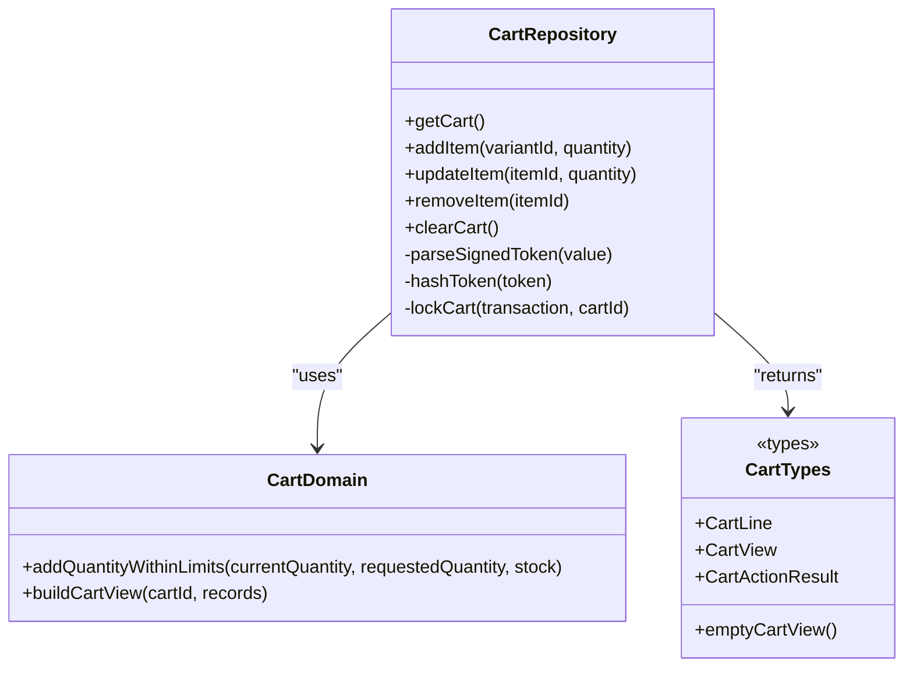

**Diagram sources**
- [lib/cart-domain.ts:1-82](file://lib/cart-domain.ts#L1-L82)
- [lib/cart-types.ts:1-41](file://lib/cart-types.ts#L1-L41)
- [lib/cart.ts:1-322](file://lib/cart.ts#L1-L322)

Key behaviors:
- Signed cookie token protects cart identity; signature verification uses HMAC and constant-time comparison.
- Transactions lock the cart row to prevent concurrent modifications.
- Quantity updates clamp to available stock and enforce maximums.
- Cart view computation marks items unavailable when products are unpublished, out of stock, or price changed.

**Section sources**
- [lib/cart-domain.ts:1-82](file://lib/cart-domain.ts#L1-L82)
- [lib/cart-types.ts:1-41](file://lib/cart-types.ts#L1-L41)
- [lib/cart.ts:1-322](file://lib/cart.ts#L1-L322)

### Server Actions for Cart
Server actions provide a validated, rate-limited interface for mutating the cart.

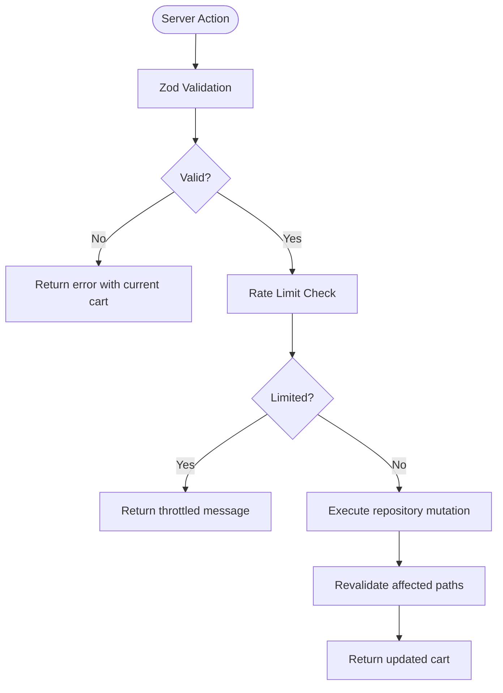

**Diagram sources**
- [actions/cart.ts:1-162](file://actions/cart.ts#L1-L162)
- [lib/cart.ts:1-322](file://lib/cart.ts#L1-L322)

Security and resilience:
- Input validation prevents malformed requests.
- In-process rate limiting reduces abuse; it is marked for replacement with a distributed limiter.
- Path revalidation keeps UI consistent after mutations.

**Section sources**
- [actions/cart.ts:1-162](file://actions/cart.ts#L1-L162)

### Checkout Flow
Checkout validates form data, checks idempotency, applies rate limits, locks inventory, and creates an order.

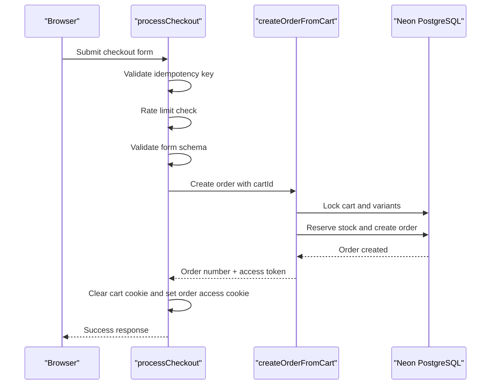

**Diagram sources**
- [actions/checkout.ts:1-110](file://actions/checkout.ts#L1-L110)
- [lib/orders.ts:1-224](file://lib/orders.ts#L1-L224)

Important guarantees:
- Idempotency prevents duplicate orders from retries.
- Advisory and row-level locking protect against race conditions during stock reservation.
- Order totals are recalculated from current variant prices.
- A hashed access token is stored; the raw token is returned once to the client.

**Section sources**
- [actions/checkout.ts:1-110](file://actions/checkout.ts#L1-L110)
- [lib/orders.ts:1-224](file://lib/orders.ts#L1-L224)

### Security and Cross-Cutting Concerns
- Signed cart cookies: HMAC-based signing and parsing ensure tamper resistance.
- Order access tokens: Random tokens are hashed with a secret before storage; verification uses constant-time comparison.
- Rate limiting: Per-process maps throttle cart and checkout endpoints; planned migration to a distributed store.
- Secure headers: Order pages disable caching and suppress referrer leakage.
- Image allowlist: Only trusted image hosts are permitted.

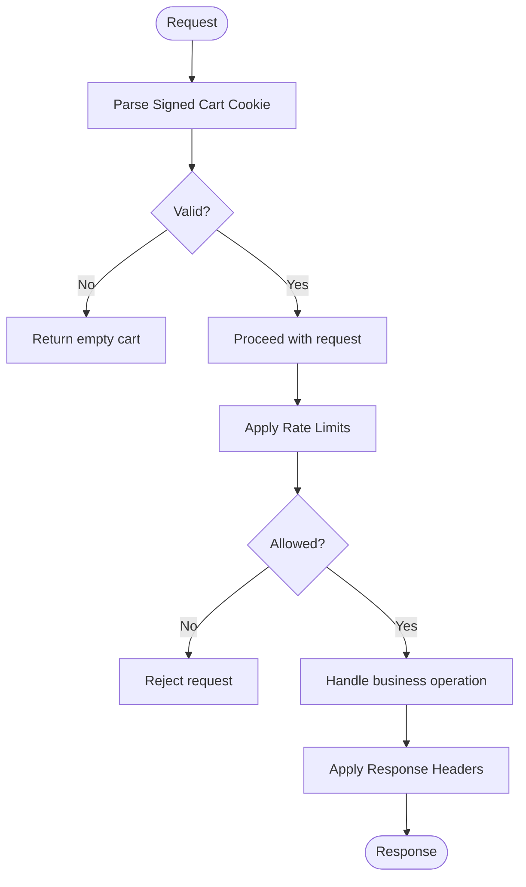

**Diagram sources**
- [lib/cart.ts:1-322](file://lib/cart.ts#L1-L322)
- [lib/crypto.ts:1-29](file://lib/crypto.ts#L1-L29)
- [lib/rate-limit.ts:1-54](file://lib/rate-limit.ts#L1-L54)
- [next.config.ts:1-45](file://next.config.ts#L1-L45)

**Section sources**
- [lib/cart.ts:1-322](file://lib/cart.ts#L1-L322)
- [lib/crypto.ts:1-29](file://lib/crypto.ts#L1-L29)
- [lib/rate-limit.ts:1-54](file://lib/rate-limit.ts#L1-L54)
- [next.config.ts:1-45](file://next.config.ts#L1-L45)

### Payment Webhook Integration Point
The payment webhook endpoint is intentionally disabled until a gateway is configured. When enabled, it must implement signature verification and idempotent processing before changing order status.

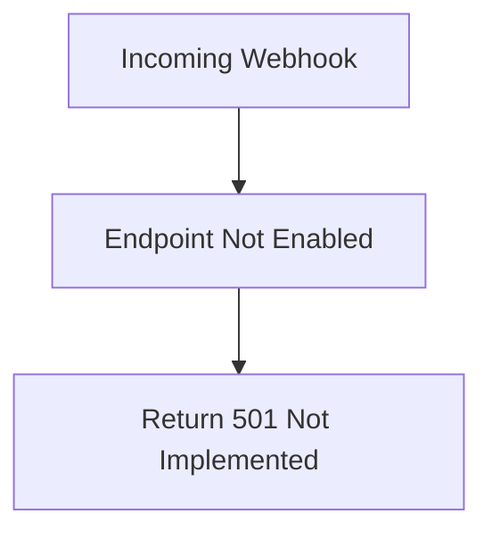

**Diagram sources**
- [app/api/webhooks/payments/route.ts:1-10](file://app/api/webhooks/payments/route.ts#L1-L10)

**Section sources**
- [app/api/webhooks/payments/route.ts:1-10](file://app/api/webhooks/payments/route.ts#L1-L10)

### Data Model and Domain Boundaries
The Prisma schema defines core domains: users, categories, products, variants, carts, orders, and related events.

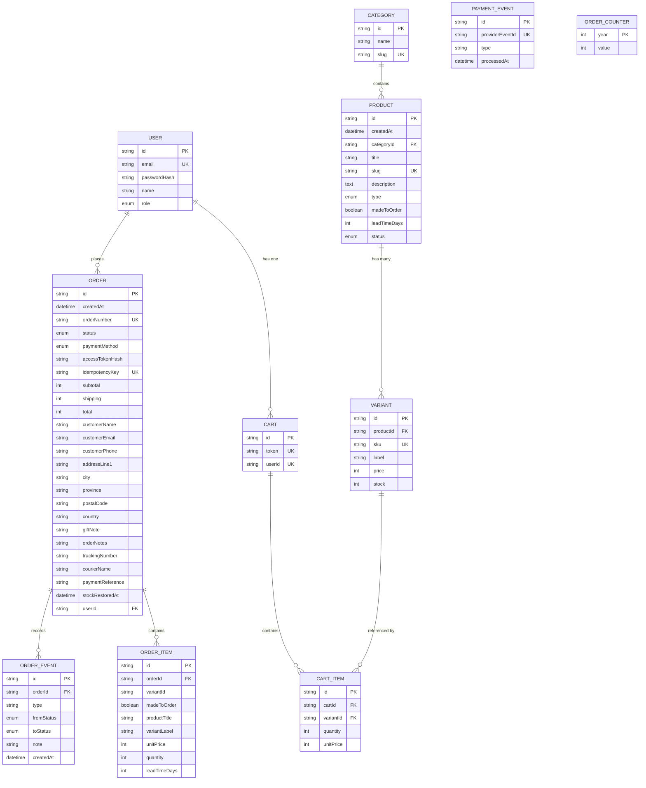

**Diagram sources**
- [prisma/schema.prisma:1-193](file://prisma/schema.prisma#L1-L193)

**Section sources**
- [prisma/schema.prisma:1-193](file://prisma/schema.prisma#L1-L193)

## Dependency Analysis
High-level dependencies between layers:

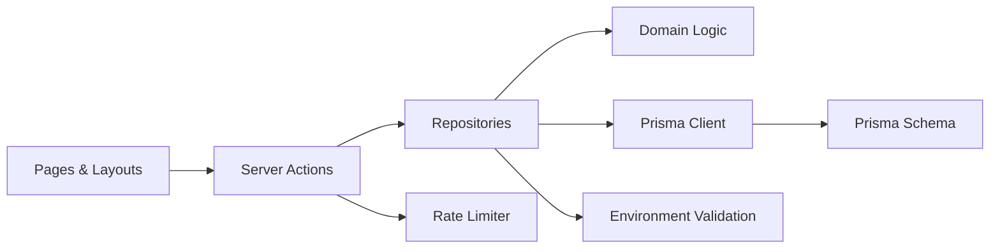

**Diagram sources**
- [app/layout.tsx:1-94](file://app/layout.tsx#L1-L94)
- [app/page.tsx:1-214](file://app/page.tsx#L1-L214)
- [actions/cart.ts:1-162](file://actions/cart.ts#L1-L162)
- [actions/checkout.ts:1-110](file://actions/checkout.ts#L1-L110)
- [lib/cart.ts:1-322](file://lib/cart.ts#L1-L322)
- [lib/orders.ts:1-224](file://lib/orders.ts#L1-L224)
- [lib/cart-domain.ts:1-82](file://lib/cart-domain.ts#L1-L82)
- [lib/rate-limit.ts:1-54](file://lib/rate-limit.ts#L1-L54)
- [lib/env.ts:1-25](file://lib/env.ts#L1-L25)
- [lib/db.ts:1-23](file://lib/db.ts#L1-L23)
- [prisma/schema.prisma:1-193](file://prisma/schema.prisma#L1-L193)

Coupling and cohesion:
- Server actions depend only on repositories and shared utilities, keeping UI concerns separate from business logic.
- Repositories encapsulate Prisma usage and transactional boundaries, improving cohesion.
- Domain functions are pure and testable, reducing coupling to infrastructure.

Potential circular dependencies:
- No direct cycles observed; imports flow from UI toward infrastructure.

External integrations:
- Neon PostgreSQL via Prisma adapter.
- Cloudinary and placeholder images allowed by Next.js configuration.
- Optional WhatsApp contact link built from environment configuration.

**Section sources**
- [package.json:24-50](file://package.json#L24-L50)
- [next.config.ts:1-45](file://next.config.ts#L1-L45)
- [lib/db.ts:1-23](file://lib/db.ts#L1-L23)

## Performance Considerations
- Server components reduce client bundle size and enable data fetching at the edge or server.
- Parallel reads on the home page improve initial load time.
- Partial prefetching and component caching are enabled in Next.js configuration.
- Turbopack is configured for faster development builds.
- Images are restricted to trusted remote patterns to avoid unnecessary network calls.
- Order pages use no-store caching to prevent stale sensitive data.

Recommendations:
- Cache static catalog data where appropriate.
- Use streaming and progressive loading for large product lists.
- Replace in-process rate limiters with a distributed store for horizontal scaling.
- Monitor database query performance and add indexes as needed.

[No sources needed since this section provides general guidance]

## Troubleshooting Guide
Common issues and mitigations:
- Missing environment variables: Startup fails if required values like database URL or secrets are absent. Validate environment early and surface clear errors.
- Invalid cart cookie: Parsing returns null; treat as empty cart and prompt user to add items.
- Stock race conditions: Transactions and advisory locks protect inventory; verify logs if conflicts occur.
- Duplicate checkout submissions: Idempotency keys return existing order numbers; guide users to contact support with the order number.
- Rate limiting: Temporary throttling messages indicate rapid retries; instruct users to wait briefly.

Operational tips:
- Use Prisma Studio to inspect entities and migrations.
- Seed admin credentials securely; passwords are hashed.
- Run tests and type checks in CI to catch regressions.

**Section sources**
- [lib/env.ts:1-25](file://lib/env.ts#L1-L25)
- [lib/cart.ts:1-322](file://lib/cart.ts#L1-L322)
- [lib/orders.ts:1-224](file://lib/orders.ts#L1-L224)
- [actions/checkout.ts:1-110](file://actions/checkout.ts#L1-L110)
- [README.md:23-33](file://README.md#L23-L33)

## Conclusion
Art Passion’s architecture separates concerns across pages, server actions, repositories, and domain logic. It emphasizes security through signed cookies, hashed tokens, and rate limiting, while leveraging Next.js server capabilities for performance. The data model cleanly represents commerce concepts, and the codebase is structured for maintainability and future extensions such as payment gateways.

[No sources needed since this section summarizes without analyzing specific files]