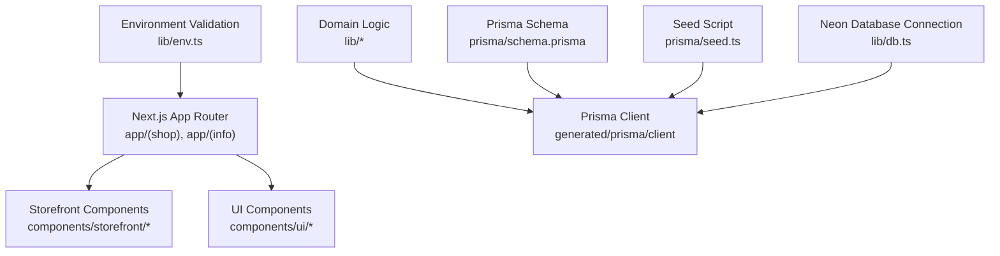
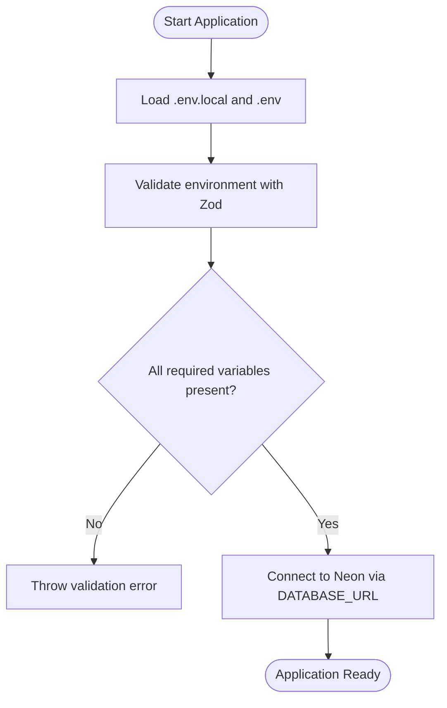
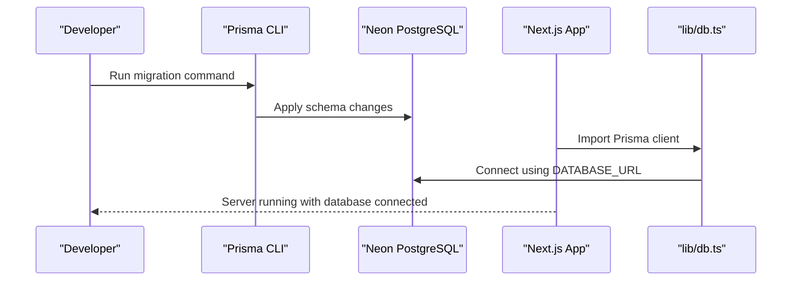
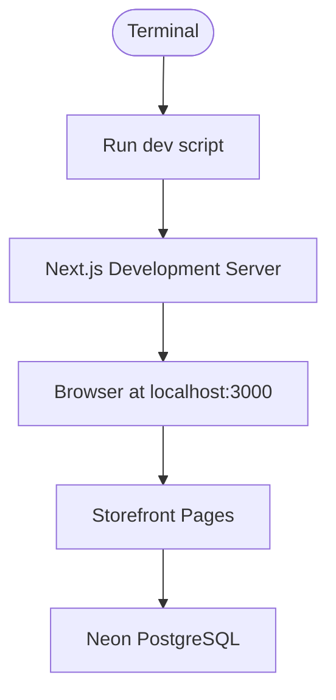
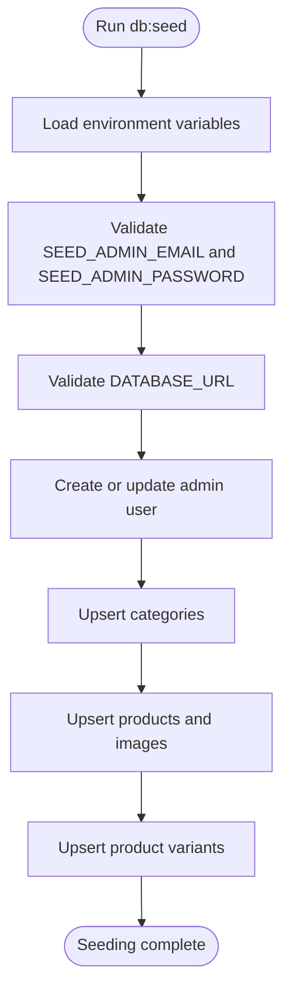

# Getting Started

<cite>
**Referenced Files in This Document**
- [README.md](file://README.md)
- [package.json](file://package.json)
- [.env.example](file://.env.example)
- [next.config.ts](file://next.config.ts)
- [prisma/schema.prisma](file://prisma/schema.prisma)
- [lib/db.ts](file://lib/db.ts)
- [lib/env.ts](file://lib/env.ts)
- [prisma/seed.ts](file://prisma/seed.ts)
</cite>

## Table of Contents
1. [Introduction](#introduction)
2. [Project Structure](#project-structure)
3. [Installation Requirements](#installation-requirements)
4. [Environment Configuration](#environment-configuration)
5. [Database Setup with Neon PostgreSQL](#database-setup-with-neon-postgresql)
6. [Development Workflow](#development-workflow)
7. [Seeding Initial Data](#seeding-initial-data)
8. [Common Setup Issues and Troubleshooting](#common-setup-issues-and-troubleshooting)
9. [Next Steps](#next-steps)

## Introduction
Art Passion is a Next.js-based storefront for handmade goods. It provides a product catalog, cart, checkout flow, order tracking, and administrative seeding utilities. The application uses Prisma with Neon PostgreSQL for data persistence and integrates Cloudinary image hosting patterns through configuration.

The project is designed to be approachable for developers new to Next.js while offering clear extension points for experienced developers who want to customize the storefront, add payment integrations, or extend the product model.

**Section sources**
- [README.md:1-3](file://README.md#L1-L3)
- [README.md:23-33](file://README.md#L23-L33)

## Project Structure
At a high level, the repository follows the Next.js App Router layout:

- `app/` contains route groups such as `(shop)` for storefront pages like products, cart, checkout, and order details, plus informational pages under `(info)`.
- `components/` separates reusable UI components from storefront-specific features.
- `lib/` holds domain logic, database access, environment validation, shipping helpers, and WhatsApp utilities.
- `prisma/` defines the data schema, migrations, and seed script.
- `public/` stores static assets.
- Configuration files include `next.config.ts`, `tsconfig.json`, `eslint.config.mjs`, `vitest.config.mts`, and `components.json`.

**Diagram sources**
- [next.config.ts:1-45](file://next.config.ts#L1-L45)
- [prisma/schema.prisma:1-193](file://prisma/schema.prisma#L1-L193)
- [lib/db.ts:1-23](file://lib/db.ts#L1-L23)
- [lib/env.ts:1-25](file://lib/env.ts#L1-L25)
- [prisma/seed.ts:1-274](file://prisma/seed.ts#L1-L274)

**Section sources**
- [next.config.ts:1-45](file://next.config.ts#L1-L45)
- [prisma/schema.prisma:1-193](file://prisma/schema.prisma#L1-L193)
- [lib/db.ts:1-23](file://lib/db.ts#L1-L23)
- [lib/env.ts:1-25](file://lib/env.ts#L1-L25)
- [prisma/seed.ts:1-274](file://prisma/seed.ts#L1-L274)

## Installation Requirements
Before starting, ensure your machine meets these requirements:

- Node.js: Use a version compatible with Next.js 16.x. The project targets modern tooling and React 19.
- Package Manager: The project declares pnpm as the package manager, but npm, yarn, and bun scripts are also provided.
- Database Access: You need a Neon PostgreSQL account and connection strings for both pooled and direct connections.

Recommended setup steps:

1. Install Node.js from the official website or your preferred version manager.
2. Install pnpm globally if you prefer using it:
   - `npm install -g pnpm`
3. Clone the repository and navigate into the project directory.
4. Install dependencies:
   - With pnpm: `pnpm install`
   - With npm: `npm install`
   - With yarn: `yarn install`
   - With bun: `bun install`

The installation triggers Prisma client generation via the postinstall hook.

**Section sources**
- [package.json:1-23](file://package.json#L1-L23)
- [package.json:24-73](file://package.json#L24-L73)
- [README.md:3-17](file://README.md#L3-L17)

## Environment Configuration
Create a local environment file by copying the example file:

- Copy `.env.example` to `.env.local`.
- Fill in the required values described below.

Required environment variables:

- `DATABASE_URL`: Pooled Neon connection string used by the server-side Prisma client.
- `DIRECT_URL`: Direct Neon connection string used by Prisma migrations.
- `CART_COOKIE_SECRET`: Secret for signing cart cookies; must be at least 32 characters.
- `ORDER_ACCESS_SECRET`: Secret for order access tokens; must be at least 32 characters.
- `ADMIN_SESSION_SECRET`: Secret for admin sessions; must be at least 32 characters.
- `WALLET_TRANSFER_DETAILS`: Wallet transfer instructions shown during checkout.
- `WHATSAPP_NUMBER`: Contact number for WhatsApp integration; accepts international digits and Pakistani mobile numbers beginning with `03`.
- `NEXT_PUBLIC_SITE_URL`: Public canonical origin for the site.

Optional environment variables:

- `SHIPPING_FLAT_RATE`: Default flat shipping rate.
- `FREE_SHIPPING_THRESHOLD`: Order subtotal threshold for free shipping.
- `SEED_ADMIN_EMAIL`: Email for the seeded administrator account.
- `SEED_ADMIN_PASSWORD`: Password for the seeded administrator account.
- `CONTACT_EMAIL`, `INSTAGRAM_URL`, `FACEBOOK_URL`, `SITE_URL`: Storefront metadata settings referenced in documentation.

Environment validation:

- The runtime environment is validated using Zod. Missing or invalid values will cause startup errors, which helps catch configuration issues early.
- Some variables have defaults, such as shipping rates and the public site URL.

Cloudinary configuration:

- Image optimization allows remote images from Cloudinary and placeholder services.
- If you use Cloudinary for uploads, configure `CLOUDINARY_CLOUD_NAME`, `CLOUDINARY_API_KEY`, `CLOUDINARY_API_SECRET`, and the public `NEXT_PUBLIC_CLOUDINARY_CLOUD_NAME`.

**Diagram sources**
- [lib/env.ts:1-25](file://lib/env.ts#L1-L25)
- [lib/db.ts:1-23](file://lib/db.ts#L1-L23)
- [next.config.ts:9-22](file://next.config.ts#L9-L22)

**Section sources**
- [.env.example:1-16](file://.env.example#L1-L16)
- [lib/env.ts:1-25](file://lib/env.ts#L1-L25)
- [lib/db.ts:1-23](file://lib/db.ts#L1-L23)
- [next.config.ts:9-22](file://next.config.ts#L9-L22)
- [README.md:25-29](file://README.md#L25-L29)

## Database Setup with Neon PostgreSQL
This project uses Prisma with Neon PostgreSQL. You need two connection strings:

- `DATABASE_URL`: Pooled connection string for the application runtime.
- `DIRECT_URL`: Direct connection string for Prisma migrations.

Steps to set up Neon:

1. Create a Neon project and database.
2. Generate connection strings for both pooled and direct access.
3. Add them to `.env.local`:
   - Set `DATABASE_URL` to the pooled connection string.
   - Set `DIRECT_URL` to the direct connection string.

Apply migrations:

- Development migration:
  - `npm run db:migrate -- --name init`
- Production deployment:
  - `npm run db:deploy`

Schema management:

- After changing `prisma/schema.prisma`, regenerate the Prisma client:
  - `npm run db:generate`
- Open the database GUI:
  - `npm run db:studio`

Server-side database client:

- The shared Prisma client is exported from `lib/db.ts`.
- It requires `DATABASE_URL` and connects through the Neon adapter.
- In non-production environments, the client instance is cached globally to avoid reconnection overhead.

**Diagram sources**
- [prisma/schema.prisma:1-193](file://prisma/schema.prisma#L1-L193)
- [lib/db.ts:1-23](file://lib/db.ts#L1-L23)
- [package.json:13-19](file://package.json#L13-L19)

**Section sources**
- [README.md:25-29](file://README.md#L25-L29)
- [package.json:13-19](file://package.json#L13-L19)
- [lib/db.ts:1-23](file://lib/db.ts#L1-L23)
- [prisma/schema.prisma:1-193](file://prisma/schema.prisma#L1-L193)

## Development Workflow
Run the development server:

- With pnpm: `pnpm dev`
- With npm: `npm run dev`
- With yarn: `yarn dev`
- With bun: `bun dev`

Open the storefront in your browser at `http://localhost:3000`.

Useful scripts:

- Build for production: `npm run build`
- Start production server: `npm run start`
- Run tests: `npm test`
- Type-check TypeScript: `npm run typecheck`
- Lint code: `npm run lint`

Image optimization:

- Remote image hosts are configured for Cloudinary and placeholder services.
- Security headers are applied to order pages to prevent caching and referrer leakage.

**Diagram sources**
- [package.json:5-12](file://package.json#L5-L12)
- [next.config.ts:23-33](file://next.config.ts#L23-L33)
- [next.config.ts:9-22](file://next.config.ts#L9-L22)

**Section sources**
- [README.md:3-17](file://README.md#L3-L17)
- [package.json:5-12](file://package.json#L5-L12)
- [next.config.ts:9-33](file://next.config.ts#L9-L33)

## Seeding Initial Data
The seed script creates starter categories, published products, product images, variants, and an administrator user.

Before seeding:

- Set `SEED_ADMIN_EMAIL` and `SEED_ADMIN_PASSWORD` in `.env.local`.
- Ensure `DATABASE_URL` is configured.

Run the seed:

- `npm run db:seed`

What the seed does:

- Creates or updates the admin user with a hashed password.
- Creates categories such as felt sets, coloring kits, and gift sets.
- Creates sample products with titles, descriptions, materials, tags, lead times, and variants.
- Assigns placeholder images and marks products as published.

Important notes:

- The seed script loads `.env.local` and `.env`.
- It validates that required seed variables and the database connection are present.
- Running the seed again updates existing records rather than duplicating them.

**Diagram sources**
- [prisma/seed.ts:1-274](file://prisma/seed.ts#L1-L274)
- [package.json:17-18](file://package.json#L17-L18)

**Section sources**
- [README.md:27-33](file://README.md#L27-L33)
- [prisma/seed.ts:1-274](file://prisma/seed.ts#L1-L274)
- [package.json:17-18](file://package.json#L17-L18)

## Common Setup Issues and Troubleshooting
- Missing `DATABASE_URL`:
  - The server-side database client throws an error when `DATABASE_URL` is not set.
  - Ensure `.env.local` contains the pooled Neon connection string.

- Migration failures:
  - Migrations require the direct connection string `DIRECT_URL`.
  - Verify that `DIRECT_URL` points to the same Neon database as `DATABASE_URL`.

- Seed script errors:
  - The seed script requires `SEED_ADMIN_EMAIL`, `SEED_ADMIN_PASSWORD`, and `DATABASE_URL`.
  - If any of these are missing, the script exits with an error.

- Environment validation errors:
  - Required secrets such as `CART_COOKIE_SECRET`, `ORDER_ACCESS_SECRET`, and `ADMIN_SESSION_SECRET` must be at least 32 characters.
  - `WHATSAPP_NUMBER` must meet minimum length requirements.
  - `NEXT_PUBLIC_SITE_URL` must be a valid URL.

- Image loading issues:
  - Remote images are allowed only for configured hosts.
  - If images do not load, verify that Cloudinary URLs match the allowed remote patterns.

- Port conflicts:
  - If port 3000 is already in use, stop the conflicting process or change the port in your environment or deployment configuration.

- Dependency installation problems:
  - If `pnpm install` fails, try clearing the cache and reinstalling.
  - Ensure your Node.js version matches the project’s expectations.

**Section sources**
- [lib/db.ts:6-10](file://lib/db.ts#L6-L10)
- [lib/env.ts:3-13](file://lib/env.ts#L3-L13)
- [prisma/seed.ts:172-183](file://prisma/seed.ts#L172-L183)
- [next.config.ts:9-22](file://next.config.ts#L9-L22)

## Next Steps
After getting the application running:

- Explore the storefront pages under the shop route group.
- Customize product categories and items by editing the seed script or extending the Prisma schema.
- Configure Cloudinary credentials if you plan to upload product images.
- Extend checkout flows and integrate additional payment providers.
- Deploy to Vercel or another platform that supports Next.js.

For deployment guidance, refer to the project’s README and the Next.js deployment documentation.

**Section sources**
- [README.md:35-44](file://README.md#L35-L44)